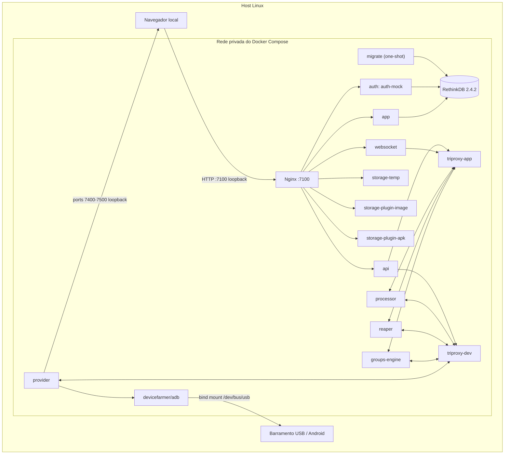

# Arquitetura

## Visão geral

A stack executa o DeviceFarmer/STF em serviços Docker Compose. O Nginx publica uma única entrada HTTP local para o painel e encaminha rotas ao app, autenticação, API, websocket e armazenamento. Os componentes STF compartilham um banco RethinkDB e trocam eventos de aplicação e dispositivos por dois triproxies ZeroMQ. Um provider gerencia os aparelhos, conecta-se ao ADB em container e disponibiliza as portas necessárias ao streaming.

## Componentes

| Serviço | Responsabilidade | Interface |
| --- | --- | --- |
| `proxy` (Nginx) | Entrada HTTP; roteia auth, API, websocket, arquivos APK/imagem e painel | Host `127.0.0.1:7100` |
| `auth` | Autenticação de desenvolvimento via `auth-mock` | Interna, porta 7100 |
| `app` | Interface web STF | Interna, porta 7100 |
| `api` | Operações da API e eventos da aplicação | Interna, porta 7100 e triproxies |
| `websocket` | Atualizações em tempo real e sessão do navegador | Interna, porta 7100 |
| `storage` | Armazenamento temporário servido pelo STF | Interna, porta 7100 |
| `storage-image`, `storage-apk` | Plugins de armazenamento de imagens e APKs | Internas, porta 7100 |
| `rethinkdb` | Banco de dados do STF; dados guardados no volume `rethinkdb-data` | Rede Compose; sem porta publicada |
| `migrate` | Migra o esquema do banco na implantação; processo termina ao concluir | One-shot; depende do banco saudável |
| `triproxy-app`, `triproxy-dev` | Transporte de mensagens entre componentes e provider | Rede Compose, ZeroMQ |
| `processor` | Processa mensagens dos triproxies | Rede Compose |
| `reaper` | Limpa alocações/sessões expiradas | Rede Compose |
| `groups-engine` | Gerencia grupos e estado de dispositivos | Rede Compose |
| `provider` | Descobre dispositivos via ADB e anuncia/controla dispositivos no STF | ADB interno; host `127.0.0.1:7400-7500` |
| `adb` | Executa o servidor ADB com acesso USB | `/dev/bus/usb` montado; sem porta publicada |

## Fluxo de acesso e dispositivos

1. O navegador conecta ao Nginx em `127.0.0.1:7100`. O Nginx encaminha cada rota ao serviço conforme `docker/compose/nginx.conf`.
2. O login é realizado pelo serviço `auth-mock`; a identidade informada não é verificada por provedor externo.
3. O app acessa API e websocket, que recebem eventos por meio dos triproxies.
4. O provider solicita a lista de aparelhos ao daemon ADB do serviço `adb`, usando a rede interna do Compose.
5. O container ADB acessa `/dev/bus/usb` do host. O Android precisa estar com depuração USB ativada e autorizar a chave ADB do container.
6. O provider anuncia o dispositivo e abre portas para o canal de controle/streaming. A faixa `7400-7500` é publicada apenas no loopback do host.

## Rede e persistência

- A rede padrão do Compose é privada ao projeto; serviços se localizam pelo nome DNS do serviço.
- Apenas o proxy HTTP e a faixa de portas do provider são publicados no host, ambos em `127.0.0.1`.
- RethinkDB não tem porta publicada no host. O volume nomeado `rethinkdb-data` persiste registros e estado entre reinicializações.
- O armazenamento de arquivos é temporário no Compose atual; conteúdo nesse serviço pode não sobreviver à recriação do container.
- Não há TLS nem autenticação de usuário real nesta configuração local.

## Configuração

`compose.yaml` recebe as variáveis de `.env`:

| Variável | Uso |
| --- | --- |
| `STF_SECRET` | Segredo usado pelos componentes STF para assinar/verificar credenciais internas |
| `STF_ADMIN_NAME` | Nome administrativo passado aos serviços STF |
| `STF_ADMIN_EMAIL` | E-mail administrativo passado aos serviços STF |
| `STF_PUBLIC_IP` | Endereço anunciado pelo provider; padrão local `127.0.0.1` |

`.env` é ignorado pelo Git. Gere um valor aleatório para `STF_SECRET`, mantenha permissões restritas e não o registre em logs, tickets ou repositórios. `.env.example` não contém valores secretos.

## Imagens

| Imagem | Fixação atual | Observação |
| --- | --- | --- |
| `devicefarmer/stf` | `3.7.9` | Tag fixa de versão, sem digest fixado |
| `rethinkdb` | `2.4.2` | Tag fixa de versão |
| `nginx` | `1.30.6-alpine3.24-slim` | Tag fixa |
| `devicefarmer/adb` | `latest` | Tag móvel; considerar fixar digest e atualizar deliberadamente |

As tags podem ser atualizadas no futuro. Antes de uma implantação duradoura, validar disponibilidade, compatibilidade e digests aprovados das imagens.

## Segurança e limitações

- `auth-mock` é adequado somente a validação individual no mesmo host. Qualquer pessoa com acesso ao painel pode escolher uma identidade. A publicação de todas as portas em loopback reduz a exposição à rede, mas não fornece isolamento entre usuários locais.
- O serviço ADB é executado com `privileged: true` e acesso a dispositivos USB. Isso amplia os privilégios do container sobre o host.
- A imagem DeviceFarmer ADB informa que contém uma chave RSA pré-carregada. Quem possuir a chave correspondente poderá autenticar-se nos aparelhos que a aceitarem; use apenas aparelho autorizado e proteja o ambiente.
- STF permite visualizar e controlar a tela, executar ações e consultar informações/logs. Não use aparelhos com dados pessoais ou contas de produção.
- Não automatize leitura, coleta, cópia ou retenção de SMS, OTPs, tokens, senhas ou notificações. Testes de autenticação devem usar homologação e contas de teste autorizadas.
- Defina um procedimento de limpeza/reset do aparelho entre sessões; o Compose não executa factory reset.
- Para vários usuários ou acesso pela rede, substitua `auth-mock` por um IdP aprovado e projete TLS, firewall, autorização e controles de acesso antes de abrir portas.
