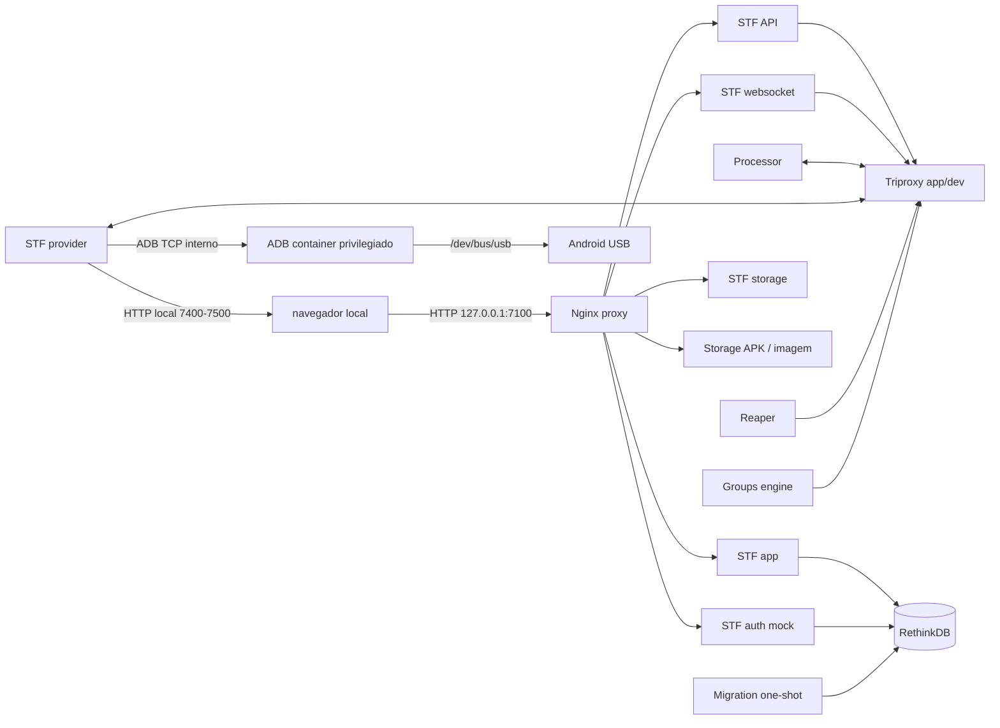

# STF Device Farm

Configuração do DeviceFarmer/STF para uma farm Android local de testes autorizados, usando Docker Compose e aparelhos conectados por USB.

## Arquitetura

O navegador acessa o painel por `http://127.0.0.1:7100`. O Nginx recebe as requisições e encaminha cada rota ao serviço STF apropriado. A comunicação entre serviços e o banco fica na rede privada criada pelo Compose. O provider acessa os aparelhos através do serviço ADB e publica os streams de vídeo em portas locais.



Consulte [ARCHITECTURE.md](ARCHITECTURE.md) para o inventário dos serviços, fluxo de acesso, portas e limites de segurança.

## Requisitos

- Ubuntu ou Linux com Docker Engine e Docker Compose v2 ou superior.
- ADB instalado no host é útil para diagnóstico; o STF usa o serviço ADB em container.
- Android com depuração USB habilitada e autorização da chave ADB do container.
- Cabo de dados USB e acesso do Docker a `/dev/bus/usb`.

O script opcional `prepare-host.sh` prepara dependências no host. Revise o script antes de executá-lo, pois ele altera o sistema operacional.

## Inicialização local

1. Copie o exemplo de ambiente e defina valores locais:

   ```bash
   cp .env.example .env
   chmod 600 .env
   openssl rand -hex 32
   ```

   Copie o valor aleatório para `STF_SECRET` em `.env`. Preencha também o nome e e-mail de teste. Não publique `.env`.

2. Valide e inicie os serviços:

   ```bash
   sudo docker compose config -q
   sudo docker compose up -d
   sudo docker compose ps
   ```

3. Abra `http://127.0.0.1:7100` no próprio host. O modo `auth-mock` aceita identidade informada pelo usuário e não verifica credenciais.

4. Conecte o aparelho, desbloqueie a tela e autorize no Android a chave ADB apresentada. Verifique a detecção:

   ```bash
   sudo docker compose exec adb adb devices -l
   ```

   O estado esperado é `device`. Se estiver `unauthorized`, aceite a solicitação de depuração USB no aparelho.

## Comandos úteis

```bash
sudo docker compose ps
sudo docker compose logs --tail=100 adb provider
sudo docker compose restart adb provider
sudo docker compose down
```

`docker compose down` mantém o volume do RethinkDB. Para apagar os dados persistentes, isso exige remover explicitamente o volume e deve ser tratado como operação destrutiva.

## Recuperação automática do ADB

O timer systemd opcional em `monitoring/` consulta o serial configurado a cada 20 segundos. Depois de observar o aparelho como `device`, aguarda 45 segundos sem esse estado e recria `adb` e `provider` uma vez. Após uma tentativa, espera o aparelho voltar antes de rearmar, evitando ciclos de reinicialização quando o cabo está desconectado ou o ADB está bloqueado.

Requisitos: systemd no host, Docker Compose funcionando e acesso administrativo ao Docker. Instale informando o serial ADB do aparelho (consulte com `sudo docker compose exec adb adb devices -l`):

```bash
sudo bash ./monitoring/install.sh SERIAL_ADB_DO_APARELHO
sudo systemctl status device-farm-adb-monitor.timer
sudo journalctl -u device-farm-adb-monitor.service
```

O serial fica em `/etc/default/device-farm-adb-monitor`, fora do repositório. O monitor não altera configurações do Samsung nem contorna o Bloqueador automático. Se o serial deixar de aparecer como `device`, ele tenta uma recuperação e aguarda o aparelho voltar.

Para remover:

```bash
sudo systemctl disable --now device-farm-adb-monitor.timer
sudo rm -f /etc/systemd/system/device-farm-adb-monitor.service /etc/systemd/system/device-farm-adb-monitor.timer /etc/default/device-farm-adb-monitor
sudo rm -rf /usr/local/libexec/device-farm-adb-monitor /var/lib/device-farm-adb-monitor
sudo systemctl daemon-reload
```

### Monitor universal (opcional)

Como alternativa independente ao monitor por serial, o monitor universal acompanha todos os aparelhos que o ADB do contêiner detectar como `device`. Ele só passa a monitorar um aparelho depois da primeira detecção bem-sucedida, espera 45 segundos de desconexão persistente e tenta recriar `adb` e `provider` uma vez até o aparelho voltar. Se vários aparelhos caírem juntos, uma única recriação atende a todos os que estiverem offline naquele momento. Aparelhos adicionados depois passam a ser acompanhados automaticamente.

Instale separadamente, sem remover o monitor por serial:

```bash
sudo bash ./monitoring/install-universal.sh
sudo systemctl status device-farm-adb-monitor-universal.timer
sudo journalctl -u device-farm-adb-monitor-universal.service
```

Os dois timers podem coexistir, mas ambos podem recriar os mesmos serviços se observarem a mesma queda simultaneamente. Para usar somente o universal, desative o timer específico por serial:

```bash
sudo systemctl disable --now device-farm-adb-monitor.timer
```

Para remover apenas o monitor universal:

```bash
sudo systemctl disable --now device-farm-adb-monitor-universal.timer
sudo rm -f /etc/systemd/system/device-farm-adb-monitor-universal.service /etc/systemd/system/device-farm-adb-monitor-universal.timer /etc/default/device-farm-adb-monitor-universal
sudo rm -rf /usr/local/libexec/device-farm-adb-monitor-universal /var/lib/device-farm-adb-monitor-universal
sudo systemctl daemon-reload
```

## Segurança e uso autorizado

- Todas as portas publicadas são vinculadas a `127.0.0.1`; não altere para `0.0.0.0` sem implementar autenticação real, TLS e controles de rede.
- `auth-mock` é somente para uma pessoa no próprio host. Qualquer pessoa com acesso local ao painel pode se identificar como qualquer nome/e-mail.
- O container ADB roda com `privileged: true` e acesso ao barramento USB para operar aparelhos. A imagem DeviceFarmer ADB inclui uma chave RSA; restrinja o host e os aparelhos a pessoas autorizadas.
- O STF transmite a tela, permite controle remoto e acesso a informações do aparelho. Use aparelhos e contas de teste aprovados. Não colete, copie ou retenha SMS, OTPs, senhas, tokens ou dados pessoais.
- Defina um processo operacional para limpar os aparelhos e encerrar sessões entre testes.
- O monitor systemd roda como root e pode recriar serviços Docker. Instale-o somente se essa recuperação automática for desejada.

## Versões

O Compose fixa STF em `devicefarmer/stf:3.7.9`, RethinkDB em `2.4.2` e Nginx em `1.30.6-alpine3.24-slim`. A imagem ADB usa a tag móvel `latest`; revise e fixe um digest para implantações duradouras. Veja [ARCHITECTURE.md](ARCHITECTURE.md) para detalhes e limitações.

## Arquivos

- `compose.yaml`: serviços, dependências, rede, volume, portas locais e integração USB.
- `docker/compose/nginx.conf`: roteamento das rotas HTTP e websocket aos serviços STF.
- `.env.example`: modelo de configuração sem credenciais.
- `prepare-host.sh`: instalação opcional das ferramentas do host.
- `monitoring/`: timer systemd opcional para recuperação de ADB.
- `ARCHITECTURE.md`: desenho e descrição da arquitetura.
